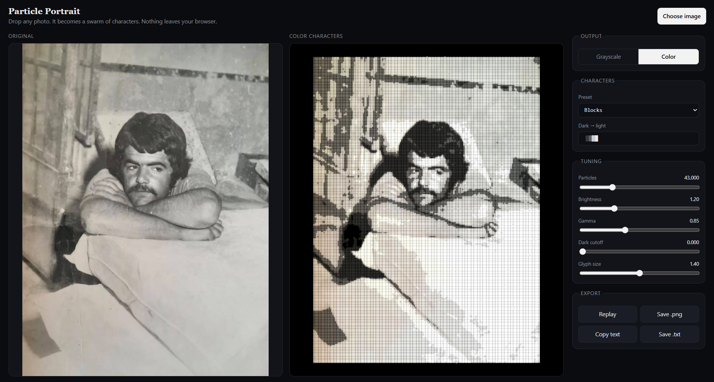

# Particle Portrait

Drop in any photo and watch it rebuild itself from thousands of text characters, drifting in and settling into place. Pick **grayscale** or **color** output, tune it live, and export the result. Everything runs in your browser; no image is uploaded anywhere.

Pure **TypeScript + WebGL2**, no runtime dependencies (Vite is used only for dev/build).



## features

- **Load any image**: drag and drop onto the page, use *Choose image*, or paste with Ctrl+V.
- **Before / after**: the original sits next to the character version.
- **Grayscale or color**: color images are converted to black and white (Rec. 709 luminance) in Grayscale mode, and keep their hues in Color mode. Also available as `?mode=color` in the URL.
- **Live settings**: character ramp (with presets), particle count, brightness, gamma, dark cutoff, glyph size.
- **Export**: PNG, plain ASCII text (`.txt`), or copy text to the clipboard. Press **Space** to replay the animation.

## run

```bash
npm install
npm run dev        # development server
npm run build      # type-check + production build into dist/
npm run preview    # serve the production build
```

Requires Node.js 18+. Deploy the `dist/` folder to any static host (for example GitHub Pages).

## how it works

1. The image is split into a grid of cells and each cell's luminance is read.
2. Each cell becomes a particle; luminance picks the character (dark → light) and the brightness. Very dark cells are skipped.
3. Particles start scattered, then gather into place left to right.
4. All motion runs on the GPU (vertex shader), so tens of thousands of particles stay smooth.
5. Drawing stops once the animation settles, saving CPU and battery.
6. The text export averages pairs of rows, because monospace characters are about twice as tall as they are wide.

## changing the sample image

Replace src/sample.jpg with your own JPEG, keeping the same file name.
**Note:** the file's real format must match its extension. `src/sample.jpg` has to be a genuine JPEG, and renaming a PNG or WebP file to `.jpg` is unreliable. Convert it properly first (or update the import in `src/ui.ts` and the declaration in `src/assets.d.ts` to match the new extension).

## settings

Defaults live in `src/config.ts` (`DEFAULTS`):

| Option          | Default     | Description                                          |
| --------------- | ----------- | ---------------------------------------------------- |
| `particleCount` | `14000`     | Approximate number of cells. More = finer detail, smaller characters. |
| `characters`    | `.:-=+*#%@` | Characters from dark to light.                       |
| `colorMode`     | `grayscale` | `"grayscale"` or `"color"`.                          |
| `brightness`    | `1.8`       | Global brightness multiplier.                        |
| `gamma`         | `0.85`      | Values below 1 open up the shadows.                  |
| `threshold`     | `0.01`      | Cells darker than this are not drawn.                |
| `glyphScale`    | `1.25`      | Glyph size relative to its cell.                     |
| `sweepDuration` | `2.4`       | Seconds for the image to sweep in left to right.     |
| `startDelay`    | `0.6`       | Seconds before gathering starts.                     |
| `damping`       | `2.4`       | Higher = particles settle faster.                    |
| `oscillation`   | `4.0`       | Overshoot-and-return speed while gathering.          |

## project structure

```
.
├── index.html            Page shell and controls
├── src/
│   ├── main.ts           Entry point
│   ├── ui.ts             Loading, drag and drop, controls, export buttons
│   ├── engine.ts         WebGL2 particle engine (ParticleEngine)
│   ├── shaders.ts        GLSL vertex + fragment shaders
│   ├── config.ts         Typed options, defaults, character presets
│   ├── style.css
│   ├── assets.d.ts       Image module typings
│   └── sample.jpg        Sample photo(see photo credit).
├── vite.config.ts
├── tsconfig.json
└── package.json
```

## browser support

Current Chrome, Edge, Firefox and Safari with WebGL2. If WebGL2 is missing, a message is shown. With "reduce motion" enabled the animation is skipped and the final picture appears immediately.

## photo credit

- Photo: `src/sample.jpg`, taken by Naz Aydemir ([@nazayd3mir](https://github.com/nazayd3mir)). The photograph shows an identifiable person, and that individual has given consent for the publication of the photograph.
- License: All rights reserved. The photo is not covered by the MIT license below and may not be copied, redistributed or used elsewhere without written permission.

## license

- Source code: [MIT](LICENSE.txt), © 2026 Naz Aydemir. The MIT license applies to the code only.
- Photo (`src/sample.jpg`): All rights reserved (see photo credit above).